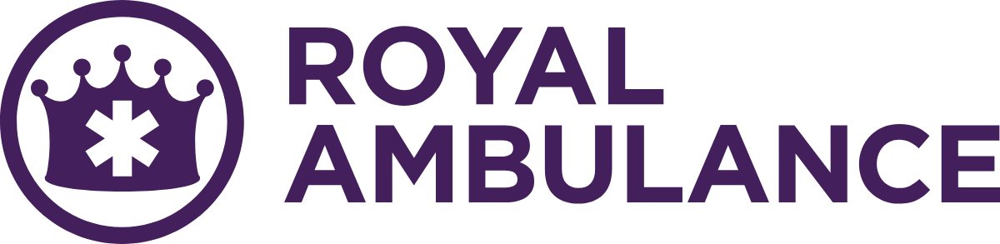

<p><picture><source media="(prefers-color-scheme: dark)" srcset="for-humans/logos/png/Royal-Ambulance-horizontal-white-1200w.png"></picture></p>

# Royal Ambulance brand kit

Royal Ambulance is a Bay Area medical transportation company under Collective Edge. This repository is the public source for the brand: logos, color, type and document layouts, with the rules for using them.

**[Read the brand guidelines](https://collective-edge.github.io/royal-brand-kit/)** · the whole standard on one page.

## Start here

| | For people | For agents |
|---|---|---|
| Who | Designers, agencies, printers, staff | An agent or a script that makes branded documents |
| Open | [`for-humans/`](for-humans/) | [`for-agents/README.md`](for-agents/README.md), then [`SKILL.md`](SKILL.md) |
| Get | [Download the pack](https://github.com/collective-edge/royal-brand-kit/archive/refs/heads/main.zip). Logos, fonts and a plain guide in one zip | Asset URLs, logo roles, color tokens and layout rules in inches, points and hex |

## Grab a logo

Pick by the ground the logo sits on. The file named **purple** goes on light. The file named **white** goes on dark. Use the SVG wherever the software takes it. Sizes, clear space and the rules are in [`for-humans/`](for-humans/#sizes-and-spacing).

| Lockup | On a light ground | On a dark ground |
|---|---|---|
| Horizontal | [SVG](for-humans/logos/svg/Royal-Ambulance-horizontal-purple.svg) · [PNG](for-humans/logos/png/Royal-Ambulance-horizontal-purple-1200w.png) | [SVG](for-humans/logos/svg/Royal-Ambulance-horizontal-white.svg) · [PNG](for-humans/logos/png/Royal-Ambulance-horizontal-white-1200w.png) |
| Stacked | [SVG](for-humans/logos/svg/Royal-Ambulance-stacked-purple.svg) · [PNG](for-humans/logos/png/Royal-Ambulance-stacked-purple-1200w.png) | [SVG](for-humans/logos/svg/Royal-Ambulance-stacked-white.svg) · [PNG](for-humans/logos/png/Royal-Ambulance-stacked-white-1200w.png) |
| Crown | [SVG](for-humans/logos/svg/Royal-Ambulance-crown-purple.svg) · [PNG](for-humans/logos/png/Royal-Ambulance-crown-purple-512w.png) | [SVG](for-humans/logos/svg/Royal-Ambulance-crown-white.svg) · [PNG](for-humans/logos/png/Royal-Ambulance-crown-white-512w.png) |

The purple in every logo file is Royal Purple `#43205b`. Use the horizontal lockup wherever it fits.

## The system at a glance

### Color

Purple is the whole palette. Dark Purple opens the document, Purple marks, Royal Purple is the logo.

| | Name | Hex | Use |
|---|---|---|---|
|  | Dark Purple | `#2f193b` | The header band. Title, divider and closing slides |
|  | Purple | `#572e72` | The primary and accent color. Links, rules, callout borders, purple text on white |
|  | Royal Purple | `#43205b` | The logo color on light backgrounds |
|  | Light Purple | `#8260a2` | Tertiary accents and hover states only. Never text |
|  | Surface 2 | `#f0e1fd` | The stronger tint. Never text |
|  | Surface | `#faf5fd` | Callout fills. Never text |
|  | White | `#FFFFFF` | The page. The default surface |

Text, rules and borders come from one neutral family, the same in all three brands. Ink is `#23232A`. Green means good and nothing else. A brand color is never a status color. Chart colors come from the house data set.

Every value: [`tokens.json`](tokens.json). Every rule: [`reference/brand.md`](reference/brand.md). Charts: [`reference/data-color.md`](reference/data-color.md).

### Type

Montserrat at 400, 600, 700 and 800. No italic. The scale is the same in all three brands.

| Role | Print | Screen |
|---|---|---|
| Headline | 30pt | 40px |
| Section heading | 24pt | 32px |
| Subhead | 18pt | 24px |
| Lead | 15pt | 20px |
| Body | 12pt | 16px |
| Table text | 10.5pt | 14px |
| Caption and footer | 9pt | 12px |

Every rule: [`reference/type-system.md`](reference/type-system.md). Every value: [`snippets/type-tokens.json`](snippets/type-tokens.json).

### Documents

Three document types. A report takes the memo page and margins and starts from [`templates/document.html`](templates/document.html).

| Type | Page | Margins | Body | Template |
|---|---|---|---|---|
| Memo | US Letter, 8.5 x 11in, portrait | 0.75in | 12pt | [`templates/memo.html`](templates/memo.html) |
| One-pager | US Letter, 8.5 x 11in, portrait, exactly one page | 0.6in | 12pt | [`templates/one-pager.html`](templates/one-pager.html) |
| Deck | 13.333 x 7.5in | 0.67in top, 0.83in left and right, 0.42in bottom | 15pt | [`templates/deck.html`](templates/deck.html) |

A document opens on one band with the logo. Content slides are white. The dark band is for the title, divider and closing slides. “Powered by Collective Edge” appears once on every Apex Paramedics and Royal Ambulance document.

Every rule: [`reference/layout.md`](reference/layout.md). The same values as data: [`documents.json`](documents.json).

## The house

Three brands, one standard. The kits differ in color, logo and brand facts.

| Brand | Guidelines | Repository |
|---|---|---|
| Collective Edge · the parent | [collective-edge.github.io/collective-edge-brand-kit](https://collective-edge.github.io/collective-edge-brand-kit/) | [`collective-edge-brand-kit`](https://github.com/collective-edge/collective-edge-brand-kit) |
| Apex Paramedics | [collective-edge.github.io/apex-brand-kit](https://collective-edge.github.io/apex-brand-kit/) | [`apex-brand-kit`](https://github.com/collective-edge/apex-brand-kit) |
| Royal Ambulance | [collective-edge.github.io/royal-brand-kit](https://collective-edge.github.io/royal-brand-kit/) | [`royal-brand-kit`](https://github.com/collective-edge/royal-brand-kit) |

## What is in here

```
royal-brand-kit/
├── index.html        The guidelines page. Built by guidelines/build.py
├── guidelines/       The page builder, its stylesheet, the brand copy and the preview image
├── for-humans/       Logos, fonts, color chips, photographs and a plain guide. For people
├── for-agents/       The shortest correct path for an agent
├── AGENTS.md         Agent entry point
├── SKILL.md          The standard in brief
├── reference/        The full standard: brand, layout, type, data color, controls
├── brands.json       Every brand in the house: CDN roots, logo roles, the co-brand lockup
├── documents.json    The document types as data
├── tokens.json       This brand's colors as hex and RGB
├── snippets/         Stylesheets, type tokens and the header band
├── templates/        Memo, one-pager, document and deck
├── Examples/         Filled references
├── assets/           Logo masters and fonts. Live CDN paths
├── scripts/          The checks and the builders
├── CONTRIBUTING.md   How to change this repository
├── NEW-BRAND.md      How to stand up a kit for a new brand
└── TRADEMARKS.md     What others may do with the names and logos
```

## Use it

### Load

Every file is public on jsDelivr. No auth, no install.

```
https://cdn.jsdelivr.net/gh/collective-edge/royal-brand-kit@main/
```

Colors are in `tokens.json`. Type is in `snippets/type-tokens.json`. Layouts are in `documents.json` and `reference/layout.md`. Logos resolve by role in `brands.json`. The stylesheet link tags for an HTML page are in [`for-agents/README.md`](for-agents/README.md).

### Verify

```bash
python3 scripts/check-sync.py
python3 scripts/validate.py path/to/output.html
python3 scripts/validate-palette.py --series
python3 scripts/ui-audit.py path/to/output.html
```

`check-sync.py` proves the shared files match the other two kits. `validate.py` checks type rules 1, 2, 5, 9, 10, 13 and 14 and check L1, retired logo artwork. `validate-palette.py` checks the chart colors. `ui-audit.py` measures a rendered page. No script reads a page the way a person does. Open the file and look.

### Versions

`main` is live. The CDN serves it and the agent reads it on every request, so a change lands whole. Production material pins a tag in place of `@main`. [`CONTRIBUTING.md`](CONTRIBUTING.md) covers changes.

### License and trademarks

The names, logos and brand colors in this repository belong to Royal Ambulance. [`TRADEMARKS.md`](TRADEMARKS.md) says what others may do with them. Permission is by request.

Montserrat is licensed under the SIL Open Font License, Version 1.1. The license text is in [`assets/fonts/OFL.txt`](assets/fonts/OFL.txt) and [`for-humans/fonts/OFL.txt`](for-humans/fonts/OFL.txt).
