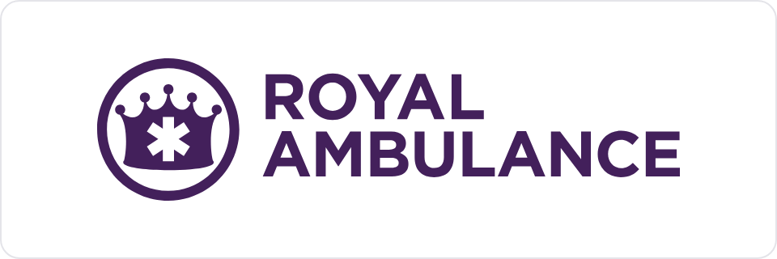
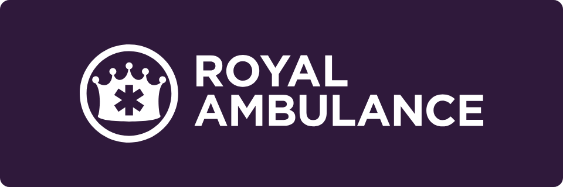

# Royal Ambulance brand kit

<p> </p>

The public source for the Royal Ambulance brand. Logos, colors, type, photographs and the rules for using them. Pick your door.

| | **[For humans →](for-humans/)** | **[For agents →](for-agents/)** |
|---|---|---|
| Who | Designers, agencies, printers, teammates | AI agents, and developers generating branded output |
| What you get | Logos in SVG and PNG, the fonts, the colors, the rules. No install, no account, no git | CDN URLs, logo roles, color tokens, the full standard, validators |
| Start with | [Download the pack](https://github.com/collective-edge/royal-brand-kit/archive/refs/heads/main.zip), then open `for-humans` | [`for-agents/README.md`](for-agents/README.md), then [`SKILL.md`](SKILL.md) |

## Grab a logo

The file named for its ink goes on the opposite background. Full set, sizes and rules are in [`for-humans/`](for-humans/).

| | For light backgrounds | For dark backgrounds |
|---|---|---|
| Horizontal | [SVG](for-humans/logos/svg/Royal-Ambulance-horizontal-purple.svg) · [PNG](for-humans/logos/png/Royal-Ambulance-horizontal-purple-1200w.png) | [SVG](for-humans/logos/svg/Royal-Ambulance-horizontal-white.svg) · [PNG](for-humans/logos/png/Royal-Ambulance-horizontal-white-1200w.png) |
| Stacked | [SVG](for-humans/logos/svg/Royal-Ambulance-stacked-purple.svg) · [PNG](for-humans/logos/png/Royal-Ambulance-stacked-purple-1200w.png) | [SVG](for-humans/logos/svg/Royal-Ambulance-stacked-white.svg) · [PNG](for-humans/logos/png/Royal-Ambulance-stacked-white-1200w.png) |
| Crown | [SVG](for-humans/logos/svg/Royal-Ambulance-crown-purple.svg) · [PNG](for-humans/logos/png/Royal-Ambulance-crown-purple-512w.png) | [SVG](for-humans/logos/svg/Royal-Ambulance-crown-white.svg) · [PNG](for-humans/logos/png/Royal-Ambulance-crown-white-512w.png) |

## The house

Three brands, one type system, the same layout in every kit.

| Brand | Kit | People | Agents |
|---|---|---|---|
| Collective Edge · the parent | [`collective-edge-brand-kit`](https://github.com/collective-edge/collective-edge-brand-kit) | [for-humans](https://github.com/collective-edge/collective-edge-brand-kit/tree/main/for-humans) | [for-agents](https://github.com/collective-edge/collective-edge-brand-kit/tree/main/for-agents) |
| Apex Paramedics | [`apex-brand-kit`](https://github.com/collective-edge/apex-brand-kit) | [for-humans](https://github.com/collective-edge/apex-brand-kit/tree/main/for-humans) | [for-agents](https://github.com/collective-edge/apex-brand-kit/tree/main/for-agents) |
| **Royal Ambulance** | this kit | [for-humans](for-humans/) | [for-agents](for-agents/) |

## About this kit

House type system v1.0. Cloud-hosted brand assets plus the `royal-brand-guidelines` skill.

Royal is an operating company under Collective Edge. It inherits the house type system unchanged and supplies two things of its own: a purple palette and the crown wordmark. Apex Paramedics and Collective Edge run the same type layer from their own kits.

Everything is served from a public jsDelivr CDN, so a document generated on one machine renders the same on every other one with no local setup.

## What is in here

```
royal-brand-kit/
├── for-humans/               # Start here if you are a person. Logos, fonts, photos, colors, rules. No install
├── for-agents/               # Start here if you are an agent. URLs, roles, tokens, rules, on one page
├── AGENTS.md                 # Entry point an agent finds on its own. Points at the two files below it
├── SKILL.md                  # The brand standard. Assets, color, type, layout, the pre-ship check
├── NEW-BRAND.md              # How to add a fourth brand to the house. Shared, byte-identical across kits
├── brands.json               # Registry of every brand, logo role and diagram role. Shared
├── tokens.json               # Color tokens for python-pptx, python-docx, matplotlib, reportlab
├── reference/
│   ├── brand.md              # Full color table, contrast traps, logo specifications, voice, sources
│   ├── layout.md             # Header band, sub-banner, flowchart nodes, stat callout, table, footer
│   ├── data-color.md         # Chart and reporting color. Series, magnitude, polarity, direction. Shared
│   ├── partner-colors.md     # Partner facility colors, sourcing and the gate. Royal only
│   └── type-system.md        # The type standard and the fifteen rules. Shared
├── snippets/
│   ├── palette.css           # The only file that differs between brands
│   ├── data-color.css        # The data color layer. Shared
│   ├── type-system.css       # The shared type layer. Shared
│   ├── type-tokens.json      # Type values for the same generators. Shared
│   ├── header-band.html      # Drop-in header band
│   └── brand-base.css        # Deprecated. A shim that forwards to the two files above it
├── templates/
│   ├── document.html         # Print-ready one-pager and report letterhead
│   └── deck.html             # Five slides at 16:9, one landscape page each
├── scripts/
│   ├── build-handoff.py      # Renders the PNG logos, previews and color chips in for-humans/
│   ├── check-sync.py         # Asserts the shared files have not forked. Shared
│   ├── validate-palette.py   # Proves a set of data colors is readable. Shared
│   └── validate.py           # Checks generated HTML against the mechanical rules. Shared
├── assets/
│   ├── colors.json           # Deprecated. Read tokens.json
│   ├── fonts/                # Montserrat variable TTF, kept for documents already pointing at it
│   └── logos/                # Horizontal, crown and stacked, purple and white
└── Examples/                 # Shipped work, with the pre-v1.0 version of each beside it
```

Shared files are byte-identical in all three kits. `scripts/check-sync.py` fails if one drifts. Never edit a shared file in this repo alone.

In `Examples/`, `NAME.html` is the shipped v1.0 file and `NAME.before.html` is the pre-v1.0 original kept beside it as the record of what changed. A `*.before.html` file is expected to fail `validate.py`: it predates the rules the validator checks. Never run the validator over it and never correct it. `Examples/HPSM_Ordering_Workflow_Manager.before.html` returns 29 violations across 7 rules, which is the point of keeping it.

## Load the assets

Two stylesheets, in this order. `type-system.css` is served from the Collective Edge kit. `palette.css` is the only file that differs.

```html
<link rel="stylesheet" href="https://cdn.jsdelivr.net/gh/collective-edge/collective-edge-brand-kit@main/snippets/type-system.css">
<link rel="stylesheet" href="https://cdn.jsdelivr.net/gh/collective-edge/royal-brand-kit@main/snippets/palette.css">
```

Style through the `.bk-*` classes and the `--fg-*`, `--bg-*` and `--border-*` variables. Reach for a raw `--royal-*` value only where the brand color is the point.

Anything with a chart, a dashboard tile or a reported number loads a third sheet, the data color layer:

```html
<link rel="stylesheet" href="https://cdn.jsdelivr.net/gh/collective-edge/collective-edge-brand-kit@main/snippets/data-color.css">
```

Chart color never comes from the brand palette. The standard is in [`reference/data-color.md`](reference/data-color.md).

For anything printed or converted to PDF, inline the `@font-face` block from `SKILL.md` and select the family on `html, body`. The declaration alone selects nothing. Do this even when Montserrat is installed on the rendering machine: a local copy makes the file render correctly on that one machine and wrong everywhere else.

## CDN base URL

```
https://cdn.jsdelivr.net/gh/collective-edge/royal-brand-kit@main/
```

Append the path inside this repo to fetch any file:

```
https://cdn.jsdelivr.net/gh/collective-edge/royal-brand-kit@main/assets/logos/horizontal-white.svg
```

## Install the skill

Clone the kit into the skills directory your agent reads. The directory name differs by tool, so substitute your own.

```bash
git clone https://github.com/collective-edge/royal-brand-kit ~/skills/royal-brand-guidelines
```

The agent picks up `SKILL.md` and applies the brand from then on. Working without one, open `SKILL.md` and follow it in order. To update:

```bash
cd ~/skills/royal-brand-guidelines && git pull
```

Recipients do not need the kit. Generated HTML pulls the assets from the CDN at render time, and a PDF carries the font embedded.

## Handing the brand to an outside partner

`for-humans/` is a self-contained pack for a design agency, printer or contractor. Logos in SVG and transparent PNG, the font as a variable file and four static weights, twenty photographs, the palette, the rules, and `Royal-Ambulance-logo-sheet.html` to open in a browser. It assumes no tooling and no access to this repo. Send the folder, or send the zip built from it.

The PNG logos, the previews and the color chips are rendered by `scripts/build-handoff.py` from `for-humans/pack.json`. When a mark or a color changes, edit the list and rerun it.

## Verify before shipping

```bash
python3 scripts/check-sync.py
python3 scripts/validate.py path/to/output.html
```

Over the whole kit, skip the pre-v1.0 originals:

```bash
python3 scripts/validate.py snippets/*.html templates/*.html \
  $(ls Examples/*.html | grep -v '\.before\.html$')
```

```bash
python3 scripts/validate-palette.py --series
```

`check-sync.py` proves the shared files have not forked and that `palette.css` still satisfies the semantic contract. `validate-palette.py` proves a set of data colors is actually readable, under color blindness and against the ground. `validate.py` checks rules 1, 2, 5, 9, 10, 13 and 14 mechanically and exits non-zero on a violation. Neither can see overlap, clipping or a fallback font. Open the rendered file and look. If your environment cannot render, say so plainly instead of claiming it looks clean.

## Color

`snippets/palette.css` is authoritative. `tokens.json` is the machine-readable copy. Full table, contrast traps and usage rules are in `reference/brand.md`.

| Name | CSS | Hex | Use |
|---|---|---|---|
| Dark Purple | `--royal-dark-purple` | `#2f193b` | Header bands, hero grounds, table header fill |
| Purple | `--royal-purple` | `#572e72` | Accent bars, callout borders, links, brand-colored text |
| Royal Purple | `--royal-royal-purple` | `#43205b` | Logo fill on light, stat numerals, flowchart action nodes |
| Light Purple | `--royal-light-purple` | `#8260a2` | Tertiary accents and hover only. Never text, never a large ground |
| Charcoal | `--royal-charcoal` | `#1E293B` | Body text on light. This is `--fg-1` |
| Surface | `--royal-surface` | `#faf5fd` | Tinted rows and callout fills |

## Deprecated, still served

`snippets/brand-base.css` and `assets/colors.json` predate v1.0 and stay on the CDN because documents already point at them. `brand-base.css` now forwards to `type-system.css` and `palette.css` and keeps the old `--royal-*` names resolving, so an old document picks up the corrected type without being edited. New work loads the two stylesheets above and reads `tokens.json`.

## Versioning

`@main` serves the latest. Pin to a tag for stability: replace `@main` with `@v1.1`. Bump the major version when a palette value or a mark changes.

## License

Brand assets are property of Royal Ambulance. Use only for Royal Ambulance and partner-related materials.
