# Royal Ambulance · logo and brand pack

Everything needed to put the Royal Ambulance brand on something. No install, no account, no git.

If you only read one line: use the SVG files, set type in Montserrat, the band is Dark Purple `#2f193b` and the accent is Purple `#572e72`.

Every Royal Ambulance PDF, deck and image carries **Powered by Collective Edge** once, small. A working document or a sheet never carries it. Read [Powered by Collective Edge](#powered-by-collective-edge).

If you are building anything with a **chart, a table of numbers or a dashboard**, read [Color for data](#color-for-data) below as well. Chart colors are a separate set. A brand color is never a chart color.

---

## Download

**[Download the whole pack](https://github.com/collective-edge/royal-brand-kit/archive/refs/heads/main.zip)** · logos, fonts and this guide in one zip. Unzip it and open the `for-humans` folder.

For one file on its own, click its **SVG** or **PNG** link in the table below, then use the download button on the page that opens.

`Royal-Ambulance-logo-sheet.html` and `data-color-sheet.html` will not render on GitHub. Download them and open them in a browser.

---

## The logos

Pick by the background you are placing it on. The file named **purple** goes on light. The file named **white** goes on dark. The name is the ink color, not the background.

| | Lockup | Files |
|---|---|---|
| 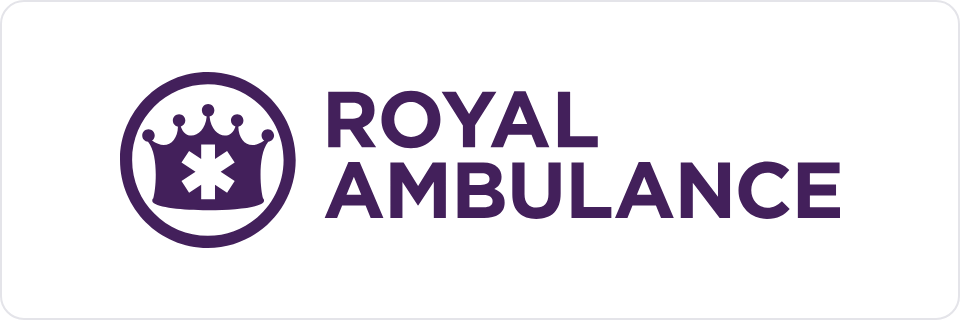 | **Horizontal · purple**<br>The primary lockup. Use it anywhere with room across. Place on white and light grounds. | [SVG](logos/svg/Royal-Ambulance-horizontal-purple.svg)<br>PNG [1200w](logos/png/Royal-Ambulance-horizontal-purple-1200w.png) · [2400w](logos/png/Royal-Ambulance-horizontal-purple-2400w.png) |
| 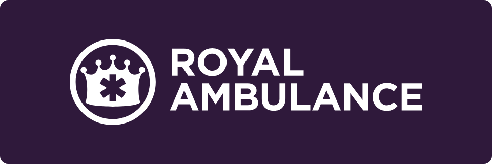 | **Horizontal · white**<br>The same lockup for dark purple grounds. | [SVG](logos/svg/Royal-Ambulance-horizontal-white.svg)<br>PNG [1200w](logos/png/Royal-Ambulance-horizontal-white-1200w.png) · [2400w](logos/png/Royal-Ambulance-horizontal-white-2400w.png) |
| 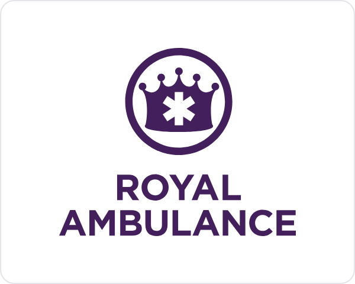 | **Stacked · purple**<br>Portrait formats, tight columns and squares. Place on white and light grounds. | [SVG](logos/svg/Royal-Ambulance-stacked-purple.svg)<br>PNG [1200w](logos/png/Royal-Ambulance-stacked-purple-1200w.png) · [2400w](logos/png/Royal-Ambulance-stacked-purple-2400w.png) |
| 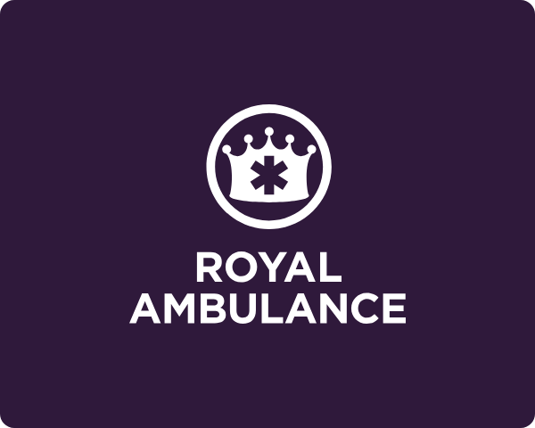 | **Stacked · white**<br>The same lockup for dark purple grounds. | [SVG](logos/svg/Royal-Ambulance-stacked-white.svg)<br>PNG [1200w](logos/png/Royal-Ambulance-stacked-white-1200w.png) · [2400w](logos/png/Royal-Ambulance-stacked-white-2400w.png) |
| 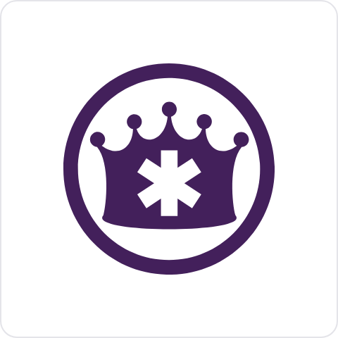 | **Crown · purple**<br>Icon only. Favicons, badges, social avatars, app tiles. Place on white and light grounds. | [SVG](logos/svg/Royal-Ambulance-crown-purple.svg)<br>PNG [512](logos/png/Royal-Ambulance-crown-purple-512w.png) · [1024](logos/png/Royal-Ambulance-crown-purple-1024w.png) |
| 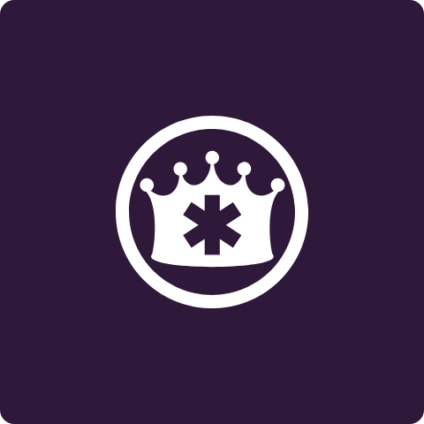 | **Crown · white**<br>The same mark for dark purple grounds. | [SVG](logos/svg/Royal-Ambulance-crown-white.svg)<br>PNG [512](logos/png/Royal-Ambulance-crown-white-512w.png) · [1024](logos/png/Royal-Ambulance-crown-white-1024w.png) |

**Use the SVG wherever the software will take it.** It is vector, so it stays sharp at any size. The PNGs are for software that will not accept SVG. They have transparent backgrounds, so the white versions look blank until you place them on something dark.

Use the horizontal lockup wherever it fits. The stacked one is for portrait and square formats. The purple in every logo file is Royal Purple `#43205b`.

Pasting a URL straight into a design tool works too. The pattern is:

```
https://cdn.jsdelivr.net/gh/collective-edge/royal-brand-kit@main/for-humans/logos/svg/Royal-Ambulance-horizontal-purple.svg
```

---

## Sizes and spacing

| Rule | Value |
|---|---|
| Clear space on all four sides | Equal to the height of the crown mark |
| Smallest the horizontal lockup may go | 110 px on screen, 1 inch in print |
| Smallest the crown may go | 32 px on screen |
| Smallest the stacked lockup may go | Use the horizontal lockup under 1.5in wide |
| Logo width in a header band | 1.6 inches |
| Width of the Powered by lockup | 204 px on a site or a dashboard. 1.25 inches in a PDF, a deck or an image |

If the clear space is short, shrink the logo. Do not crop the space.

## Do not

- Stretch, squash, skew or rotate it.
- Recolor it. Pick the file that matches the background instead.
- Change the color to anything but Royal Purple `#43205b` or white.
- Pull the crown apart from the wordmark in the horizontal lockup.
- Add a drop shadow, glow, outline or gradient.
- Put it on a busy photo without a solid backing panel behind it.
- Crop the clear space to make it fit. Shrink the logo instead, down to the minimum.
- Use it below the minimum sizes above.
- Merge it with another logo into one shape.

---

## Powered by Collective Edge

Royal Ambulance is an operating company under Collective Edge, and the reader should be able to see it. The phrase **Powered by Collective Edge** appears once on everything Royal Ambulance delivers as a PDF, a deck or an image: a one-pager, a report, a memo, a proposal, a deck. A working document, the kind people keep editing in Google Docs or Word, never carries it. Neither does a sheet. That holds even when a working document is later saved as a PDF.

On a site or a dashboard it is a lockup: the words POWERED BY above the Collective Edge logo, under a thin rule. In a PDF, a deck or an image it is smaller and quieter: the words Powered by, then the Collective Edge logo on the same line, 1.25 inches wide. It sits beside the operating company's logo and never inside it.

| Part | Value |
|---|---|
| The words, on a site | `POWERED BY`. Montserrat SemiBold 600, uppercase, letter-spaced 0.08em, 12 px |
| The words, in a PDF, a deck or an image | `Powered by`. Montserrat Regular 400, 9pt. 12pt on a closing slide |
| Color of the words | `#6D6D77` on white. `#A3A4AC` on a dark band |
| The logo on white | The black Collective Edge horizontal lockup · [SVG](https://github.com/collective-edge/collective-edge-brand-kit/blob/main/for-humans/logos/svg/Collective-Edge-horizontal-black.svg) · [PNG](https://github.com/collective-edge/collective-edge-brand-kit/blob/main/for-humans/logos/png/Collective-Edge-horizontal-black-1200w.png) |
| The logo on a dark band | The white Collective Edge horizontal lockup · [SVG](https://github.com/collective-edge/collective-edge-brand-kit/blob/main/for-humans/logos/svg/Collective-Edge-horizontal-white.svg) · [PNG](https://github.com/collective-edge/collective-edge-brand-kit/blob/main/for-humans/logos/png/Collective-Edge-horizontal-white-1200w.png) |
| Logo width | 204 px on a site or a dashboard. 1.25 inches, which is 120 px, in a PDF, a deck or an image. Never below 120 px |
| Gap between the words and the logo | 12 px on a site, the logo under the words. 6pt in a document, the logo beside the words |
| The rule above it | 1px. `#E4E4E9` on white. White at 12 percent opacity on a dark band. 24 px, 0.25 in, of space above the rule and below it. On a site only. In a document the footer rule does this job |
| How often | Once per PDF, deck or image. Never on a working document or a sheet |

Where it goes:

- The footer of a site.
- The footer row of a memo or a one-pager, at left, on page 1.
- The last line of a report body.
- The footer row of the closing slide of a deck.
- A chart or data graphic made on its own: one line of words at bottom right, `Powered by Collective Edge`, and no logo.
- The sidebar header of a dashboard.
- A data page or a methodology page.

Do not:

- Put it on the operating company's own logo or inside that lockup.
- Merge, nest or recolor either logo to match the other.
- Use it twice on one document.
- Type the phrase as plain text where the logo fits.
- Shrink it to the 120 px minimum on a site or a dashboard. 204 px is the size there.
- Set it larger than 1.25 inches in a PDF, a deck or an image.
- Put it on a working document or a sheet, as a logo or as words.
- Put it on a clinical instruction, or on a patient-facing consent or safety document. Those carry the operating company's logo alone.

### Whose page it is

Ask whose name is on the door. On this page the partner is Royal Ambulance.

| | The partner's own material · the default | A Collective Edge product delivered to a partner |
|---|---|---|
| Whose colors | The partner's, everywhere | Black, white and gray, plus the partner's accent color on active and live states only |
| Where Collective Edge appears | Under a thin rule, beside the partner's logo, with POWERED BY above it | First in the row: Collective Edge, then the partner, then their customer |

When in doubt, it is the partner's material. Collective Edge does not take over a partner's page. Keep a 1px rule between two logos and never put more than three logos in one row.

### The Collective Edge block mark

When the Collective Edge block mark stands on a Royal page, its wedge is Royal purple `#572E72`. Use the shipped file from the Collective Edge pack: [black, for light grounds](https://github.com/collective-edge/collective-edge-brand-kit/blob/main/for-humans/logos/svg/Collective-Edge-mark-black-royal.svg) · [white, for dark grounds](https://github.com/collective-edge/collective-edge-brand-kit/blob/main/for-humans/logos/svg/Collective-Edge-mark-white-royal.svg). Never recolor one by hand.

Every other Collective Edge file is in the [Collective Edge pack](https://github.com/collective-edge/collective-edge-brand-kit/tree/main/for-humans).

---

## Color

Purple is the whole palette. Dark Purple opens the document, Purple marks, Royal Purple is the logo. Hex and RGB are the authoritative values. Everything else gets converted from these.

### Brand colors

| | Name | Hex | RGB | What it is for |
|---|---|---|---|---|
|  | Dark Purple | `#2f193b` | 47, 25, 59 | The dark band. Header bands, table header rows, title, divider and closing slides. The band carries no rule |
|  | Purple | `#572e72` | 87, 46, 114 | The working accent. Buttons, links, rules, callout borders, purple text on white |
|  | Royal Purple | `#43205b` | 67, 32, 91 | The logo color on light backgrounds |
|  | Light Purple | `#8260a2` | 130, 96, 162 | Tertiary accents and hover states only. Never body text. Never a large background |
| 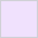 | Surface 2 | `#f0e1fd` | 240, 225, 253 | The stronger tint, a step under Surface. Never text |
|  | Surface | `#faf5fd` | 250, 245, 253 | Callout fill. Never text |
|  | White | `#FFFFFF` | 255, 255, 255 | The page. The default surface |

### Neutrals

Text, rules and borders. One gray family, the same in Collective Edge, Apex Paramedics and Royal Ambulance.

| | Name | Hex | RGB | What it is for |
|---|---|---|---|---|
|  | Ink | `#23232A` | 35, 35, 42 | Body text and headings. 15.61:1 on white |
|  | Secondary | `#565860` | 86, 88, 96 | Secondary text. 7.09:1 on white |
|  | Tertiary | `#6D6D77` | 109, 109, 119 | Captions and metadata. The lightest gray that may carry text. 5.12:1 on white |
|  | Dimmed | `#8A8B93` | 138, 139, 147 | Marks only. Never text. 3.39:1 on white |
| 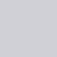 | Border | `#D0D0D6` | 208, 208, 214 | Borders and table rules |
|  | Hairline | `#E4E4E9` | 228, 228, 233 | Hairlines and dividers |
|  | On-dark body | `#DDDDE3` | 221, 221, 227 | Body text on a dark band |
|  | On-dark caption | `#A3A4AC` | 163, 164, 172 | Captions on a dark band |

### Alert colors

Four meanings, the same in every brand. Green means good and nothing else. A brand color is never a status color. A word or an icon always travels with the color.

| Meaning | Fill, rule or dot | Text on white | Pale fill | On a dark band |
|---|---|---|---|---|
| **Go**<br>Cleared, on time, in service, good news |  `#1E7A4D` |  `#1E7A4D` | 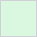 `#DAF8DF` |  `#56B580` |
| **Warn**<br>At risk, pending, watch | 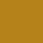 `#B5821A` | 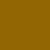 `#926603` | 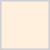 `#FFEFDD` |  `#E9B457` |
| **Stop**<br>Failed, out of service, blocked, bad news |  `#B0322B` |  `#B0322B` |  `#FDE9E6` |  `#EB685C` |
| **Info**<br>A neutral notice |  `#2A5A8C` |  `#2A5A8C` |  `#E3F0FF` |  `#5796D9` |

Text on a pale fill takes the "Text on white" value. The Warn fill `#B5821A` is never text. Warn text is `#926603`.

### What to watch

- **Light Purple `#8260a2` is never body text and never a large background.** It is a tertiary accent and a hover state, nothing more.
- **Never put Light Purple `#8260a2` on Dark Purple `#2f193b`.** It measures 3.13:1 and fails at every size.
- **White text belongs only on Dark Purple, Purple or Royal Purple.** Never white on Light Purple.
- **Tertiary `#6D6D77` is the lightest gray that carries text.** Dimmed `#8A8B93` is never text, at any size.
- **On Surface 2 `#f0e1fd`, set small text in Secondary `#565860`.** Tertiary measures 4.12:1 there.
- **On a dark band, headings are white `#FFFFFF`, body text is `#DDDDE3` and captions are `#A3A4AC`.**
- **These colors are for the brand.** They are not what you make a chart with. See [Color for data](#color-for-data).

No Pantone or CMYK build is specified for this brand. For offset or large-format work, convert from the hex values above and send a proof before the run.

---

## Color for data

Skip this if you are making a logo, a sign or a business card. Read it if anything you are making has a chart, a graph, a dashboard, a scorecard or a table of numbers.

**Chart colors are a separate set, and they are the same in every one of our brands.** A chart made for Royal Ambulance reads the same inside an Apex Paramedics or a Collective Edge document. No chart color is a brand color, and no brand color is a chart color.

### The one rule

When there is data on the page, color has a job: separate things, and signal things. The brand is carried by the band at the top, the logo and the typeface. Not by the bars.

### Series colors · telling things apart

For charts with more than one line, bar group or slice. **Use them in this order, starting at the first one.** Do not pick the ones you like and do not reorder them. The order is what keeps neighboring colors distinguishable, including for the roughly one man in twelve who cannot separate red from green.

| Slot | Name | On white | On a dark band |
|---|---|---|---|
| 1 | Blue |  `#2063e6` |  `#0986e4` |
| 2 | Orange |  `#eb6f32` |  `#fc803e` |
| 3 | Magenta |  `#b93388` |  `#c4588d` |
| 4 | Umber |  `#7f3810` | 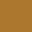 `#ac772e` |
| 5 | Violet |  `#8a72f7` |  `#ac94fd` |
| 6 | Olive |  `#819808` |  `#b1d454` |
| 7 | Sky |  `#259cde` |  `#74c8fc` |

None of the seven is green or red. Green and red belong to the direction colors below.

Seven is the limit. If you need an eighth, group the smallest ones into "Other" or split the chart in two. Do not invent a color. On scatter plots, bubble charts and maps, where any two dots can end up touching, the limit is four on white and three on a dark band.

### Direction colors · telling the reader how to feel

Separate from the series colors, and never mixed with them. These are the alert colors, used on a number.

| | Name | Hex | Pale fill | Text on that fill | On a dark band |
|---|---|---|---|---|---|
|  | Favorable | `#1E7A4D` | `#DAF8DF` | `#1E7A4D` | `#56B580` |
|  | Unfavorable | `#B0322B` | `#FDE9E6` | `#B0322B` | `#EB685C` |
|  | Caution | `#926603` | `#FFEFDD` | `#926603` | `#E9B457` |
|  | Neutral | `#6D6D77` | `#F0F1F4` | `#565860` | `#A3A4AC` |

**The part that is easy to get backwards.** Green does not mean the number went up. Green means the news is good.

In one of our reports, transports rose 6.3 percent and hospital invoice costs fell 38.8 percent. One number went up, one went down, and both were good news. Both are green. The little arrow shows which way the number moved. The color shows whether that is good.

Coloring a 38.8 percent cost saving red because it has a minus sign in front of it tells the reader we made things worse.

**Always put an arrow or an icon and a word next to the color.** Never the color on its own. Decks get printed in black and white, projected onto washed-out screens, and read by people who cannot see the difference between your red and your green.

### The before-and-after chart

The most common chart we make, and the one most often got wrong.

Do not use a light shade of one color for "before" and a dark shade of it for "after". They are too close together, so the reader has to stop and read the labels to work out which bar is which.

Use a plain gray for the baseline and the first series color for the result:

- Baseline bar · `#D0D0D6`
- Label on the baseline bar · `#6D6D77`
- Result bar · `#2063e6`
- Target or benchmark line · `#8A8B93`
- The change, as a pill with an arrow and a word · direction colors above
- The headline number stated once, in dollars rather than a percentage

Gray against blue reads instantly. That is the whole fix.

### Above and below a line

For a value that sits over or under a baseline: budget variance, days ahead or behind. Red below, blue above, gray in the middle. Not red and green.

| Furthest below | | | No difference | | | Furthest above |
|---|---|---|---|---|---|---|
| `#d05045` | `#f67a6d` | `#f9b8af` | `#E4E4E9` | `#afcbfe` | `#71a3fe` | `#467ce1` |

### The ramp · for "how much"

For heatmaps and intensity grids, where one quantity gets darker as it gets bigger. This is the one data color that follows the brand: each brand has its own ramp, and it ends on that brand's color. Use the ramp of the brand whose document it is. Light to dark:

| Brand | 100 | 200 | 300 | 400 | 500 | 600 | 700 |
|---|---|---|---|---|---|---|---|
| Collective Edge | 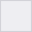<br>`#EEEEF2` | <br>`#D3D4D9` | <br>`#B6B7BD` | <br>`#97989F` | <br>`#76777F` | <br>`#51525A` | <br>`#23232A` |
| Apex Paramedics | <br>`#E5EAFF` | 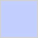<br>`#C2CFFE` | <br>`#A0B1F1` | <br>`#8193DE` | <br>`#6374C9` | <br>`#4452B1` | <br>`#2B338D` |
| Royal Ambulance | <br>`#f0e1fd` | 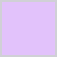<br>`#e2c2fb` | <br>`#d29ef8` | <br>`#ba7ce4` | <br>`#9d60c6` | <br>`#7f42a6` | <br>`#572e72` |

Start at step 300 for anything with distinct steps, like funnel stages. Steps 100 and 200 are so pale they are only usable on a smooth gradient.

On a dark band the ramp flips. The lightest step is the largest value:

| Brand | 100 | 200 | 300 | 400 | 500 | 600 | 700 |
|---|---|---|---|---|---|---|---|
| Collective Edge | `#37383C` | `#4C4D52` | `#626369` | `#7C7D84` | `#9698A0` | `#B6B7BE` | `#DCDDE4` |
| Apex Paramedics | `#20285A` | `#313C7A` | `#45539F` | `#5A6BC7` | `#7286EA` | `#95A8FA` | `#C2CFFF` |
| Royal Ambulance | `#3d1f52` | `#572e72` | `#7f42a6` | `#9d60c6` | `#ba7ce4` | `#d29ef8` | `#e2c2fb` |

**Never use a ramp for things that merely have names.** Facilities, payers and crews are not more or less of anything, and shading them light to dark invents a ranking that is not there. Use the series colors.

### Quick don't list

- A brand color as a chart color.
- A brand color as a status color. Green means good only.
- Two shades of one color standing in for two different things.
- Red and green as the two ends of one scale. Use red and blue.
- A red number when the news is good.
- An eighth series color.
- Series colors out of order.
- Any color doing its job without a label.

### If you want to check your own work

Everything above was measured, not picked by eye. If you have a set of colors you want tested, send them to us and we will run them, or run it yourself from the full download:

```
python3 scripts/validate-palette.py "#2063e6,#eb6f32,#b93388"
```

It reports whether the colors can be told apart and whether they have enough contrast against the page.

---

## Type

The brand is set in **Montserrat** throughout. There is no secondary typeface.

The four weights the brand uses are in [`fonts/static/`](fonts/static/), one file each. Install these if your software asks for a font file: Word, PowerPoint, Keynote, a handbook platform, a sign shop.

| Weight | File | Used for |
|---|---|---|
| Regular 400 | [`Montserrat-Regular.ttf`](fonts/static/Montserrat-Regular.ttf) | Body text, captions, footers, table cells |
| SemiBold 600 | [`Montserrat-SemiBold.ttf`](fonts/static/Montserrat-SemiBold.ttf) | Subheads, uppercase labels, table headers |
| Bold 700 | [`Montserrat-Bold.ttf`](fonts/static/Montserrat-Bold.ttf) | Page titles, section headings, emphasis inside body text |
| ExtraBold 800 | [`Montserrat-ExtraBold.ttf`](fonts/static/Montserrat-ExtraBold.ttf) | Title slides and hero bands only |

Use three weights at most in one document. A deck is the one piece that uses all four. Do not set italic, at any weight, and do not let software fake one.

The single variable font file in [`fonts/`](fonts/) carries every weight in one file, for web and design tools that read a weight axis. Montserrat is also free from Google Fonts at https://fonts.google.com/specimen/Montserrat.

| Text | Size in print | Weight |
|---|---|---|
| Page title | 30pt | Bold 700 |
| Section heading | 24pt | Bold 700 |
| Subhead | 18pt, then 15pt | SemiBold 600 |
| Body | 12pt. Never below 10.5pt | Regular 400 |
| Caption, footer | 9pt. Nothing smaller | Regular 400 |
| Uppercase label | 9pt, letter-spaced 0.08em | SemiBold 600 |

Headings inside a document are sentence case. Uppercase is for the band title and the title slide title. It is always letter-spaced and never runs past four words. Text is flush left. Never justified. A line of body text stops at about 70 characters.

## Documents and decks

The same in every brand. Only the colors and the logo change.

| Item | Value |
|---|---|
| Page | US Letter, 8.5 × 11 in |
| Working document | The default for anything people keep editing in Google Docs or Word. The logo at top left, a title, plain headings, 10.5pt text, a one-line footer. No header band |
| Sheet | One table per tab, starting at A1. Montserrat 10pt. A frozen header row with a light fill |
| Margins, working document, memo and report | 0.75 in on all four sides |
| Margins, one-pager | 0.6 in on all four sides |
| Page color | White `#FFFFFF`. Body text `#23232A` |
| Logo | Once per document: in the header band of a one-pager, a report or a memo, at top left of a working document. Once per slide at most |
| Slide | 16:9, 13.333 × 7.5 in |
| Slide body text | 15pt |
| Content slides | White `#FFFFFF` |
| Title, divider and closing slides | The dark band, Dark Purple `#2f193b` |
| Powered by Collective Edge | Once per PDF, deck or image, small. Never on a working document or a sheet. See [Powered by Collective Edge](#powered-by-collective-edge) |

## Writing, if you are setting copy

- Short declarative sentences. Active verbs. Nothing before the point.
- No em dashes. Use a period, a comma, or `·`.
- Exact values. The real number, not a rounded one.
- A label and a value, nothing between them. No helper text under a field, no caption restating the number above it.
- Name partners and facilities exactly the way they write themselves.

---

## Photos

Twenty photographs of Royal people at work, chosen for a culture code or a handbook. People first, smiling, across crews, the communications center, training and team events. Full frame, JPEG, up to 3200 pixels on the long edge. [`photos/manifest.csv`](photos/manifest.csv) links each one to its full-resolution original for print.

Use them as they are. Do not add filters, recolor, mirror or composite them. Crop freely. Photos go behind a solid panel if a logo has to sit on top.

| | Photo | Suggested use | Pixels |
|---|---|---|---|
| 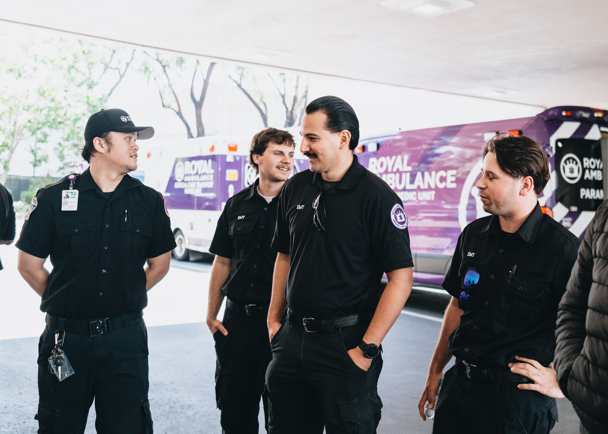 | [Crew sharing a laugh](photos/01-royal-crew-sharing-a-laugh.jpg) | Opening / culture | 3200 × 2285 |
|  | [Smiling dispatcher at work](photos/02-royal-smiling-dispatcher-at-work.jpg) | People / communications | 3200 × 2132 |
| 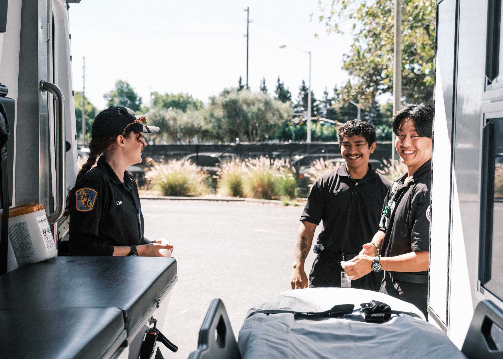 | [Crew at the ambulance doors](photos/03-royal-crew-at-the-ambulance-doors.jpg) | Teamwork / everyday work | 2000 × 1429 |
| 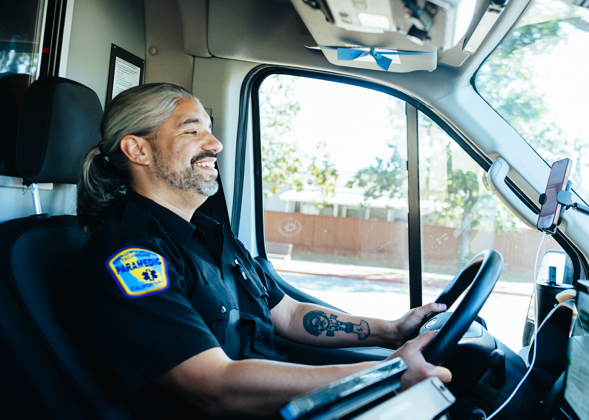 | [A smile from the cab](photos/04-royal-a-smile-from-the-cab.jpg) | Everyday work / people | 2048 × 1464 |
|  | [Team recognition beside the Royal rig](photos/05-royal-team-recognition-beside-the-royal-rig.jpg) | Opening / shared pride | 3200 × 2400 |
| 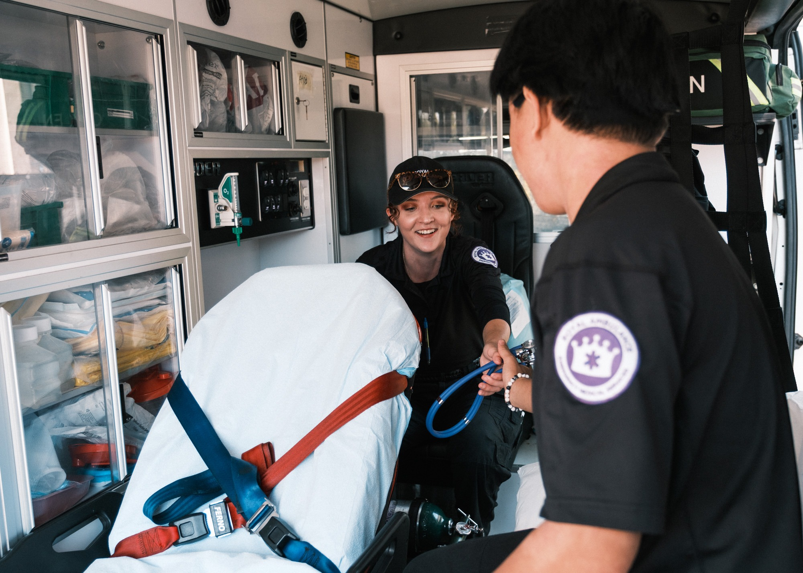 | [A friendly moment inside the rig](photos/06-royal-a-friendly-moment-inside-the-rig.jpg) | Culture / teamwork | 2000 × 1429 |
|  | [Dispatcher smiling at the console](photos/07-royal-dispatcher-smiling-at-the-console.jpg) | People / communications | 3200 × 2132 |
| 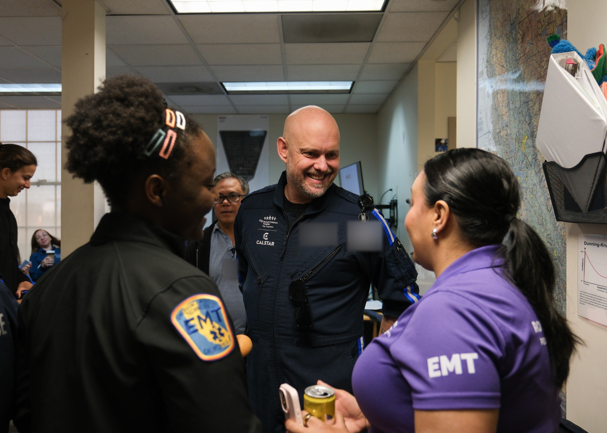 | [Conversation during NICU training](photos/08-royal-conversation-during-nicu-training.jpg) | Learning / collaboration | 3200 × 2286 |
| 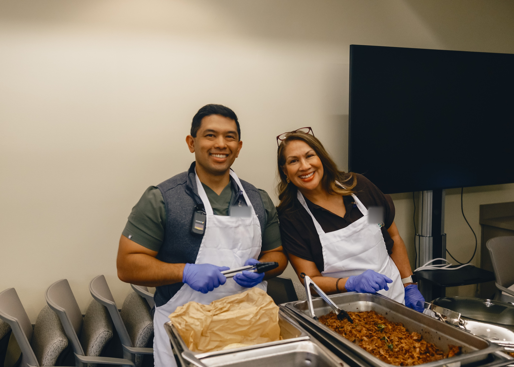 | [Colleagues serving a team meal](photos/09-royal-colleagues-serving-a-team-meal.jpg) | Care for colleagues / culture | 3200 × 2286 |
| 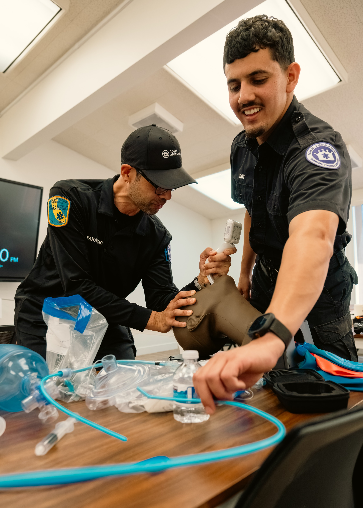 | [Hands-on clinical practice](photos/10-royal-hands-on-clinical-practice.jpg) | Learning / professional development | 2286 × 3200 |
| 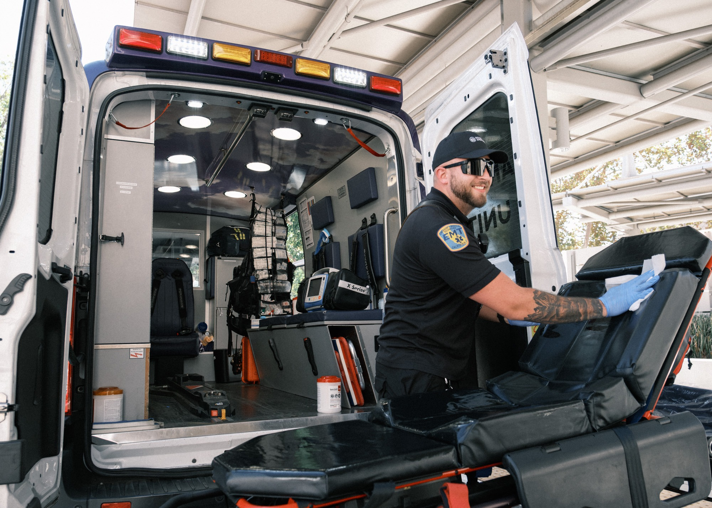 | [Equipment preparation at the rig](photos/11-royal-equipment-preparation-at-the-rig.jpg) | Everyday work / readiness | 2000 × 1429 |
| 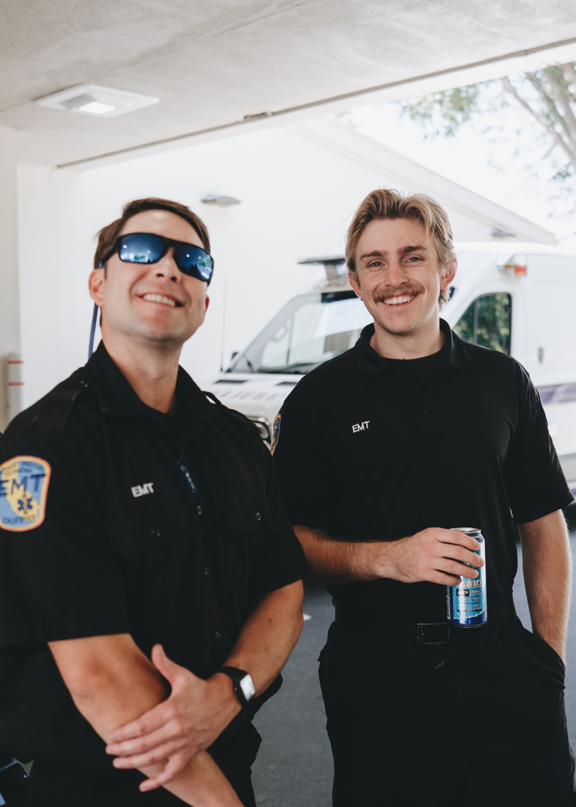 | [Two colleagues, one easy smile](photos/12-royal-two-colleagues-one-easy-smile.jpg) | People / belonging | 2286 × 3200 |
|  | [Warm portrait at a workstation](photos/13-royal-warm-portrait-at-a-workstation.jpg) | People / support teams | 2220 × 3200 |
|  | [NICU training team together](photos/14-royal-nicu-training-team-together.jpg) | Learning / collaboration | 3200 × 2133 |
| 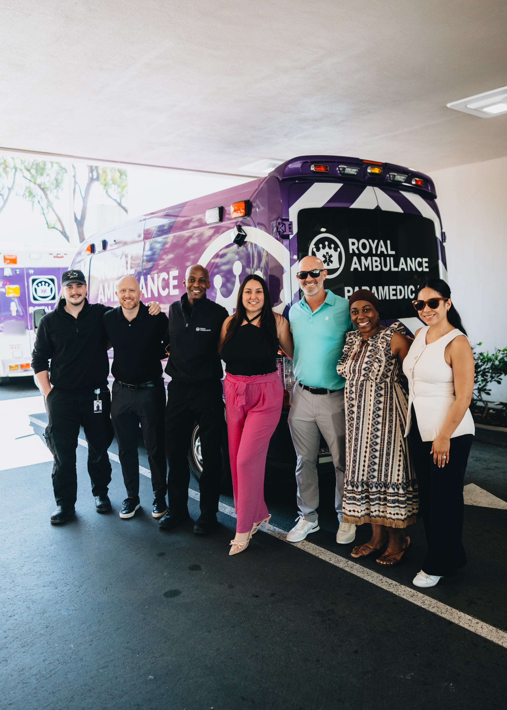 | [A wider Royal team](photos/15-royal-a-wider-royal-team.jpg) | Belonging / culture | 2285 × 3200 |
|  | [Serving colleagues at the team meal](photos/16-royal-serving-colleagues-at-the-team-meal.jpg) | Culture / supporting one another | 3200 × 2286 |
| 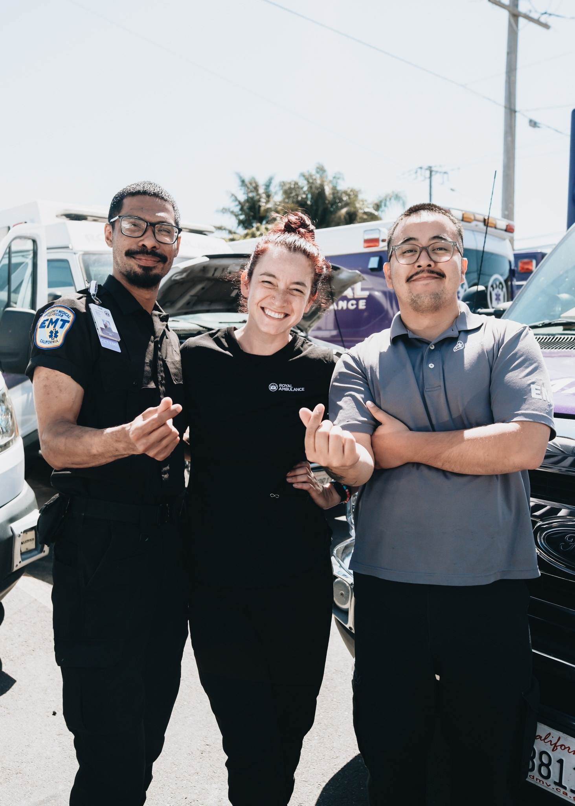 | [Three colleagues celebrating together](photos/17-royal-three-colleagues-celebrating-together.jpg) | Team pride / people | 1463 × 2048 |
| 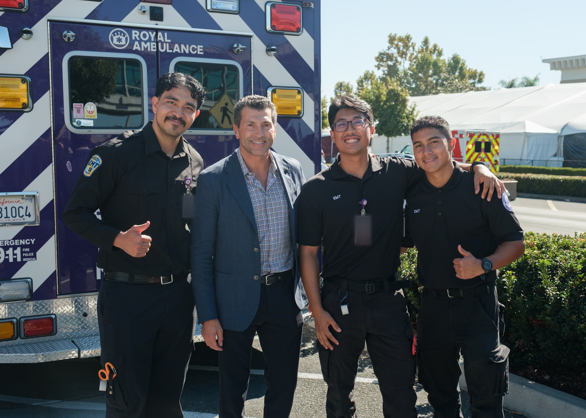 | [Crew recognition at the ambulance](photos/18-royal-crew-recognition-at-the-ambulance.jpg) | Recognition / teamwork | 3200 × 2286 |
| 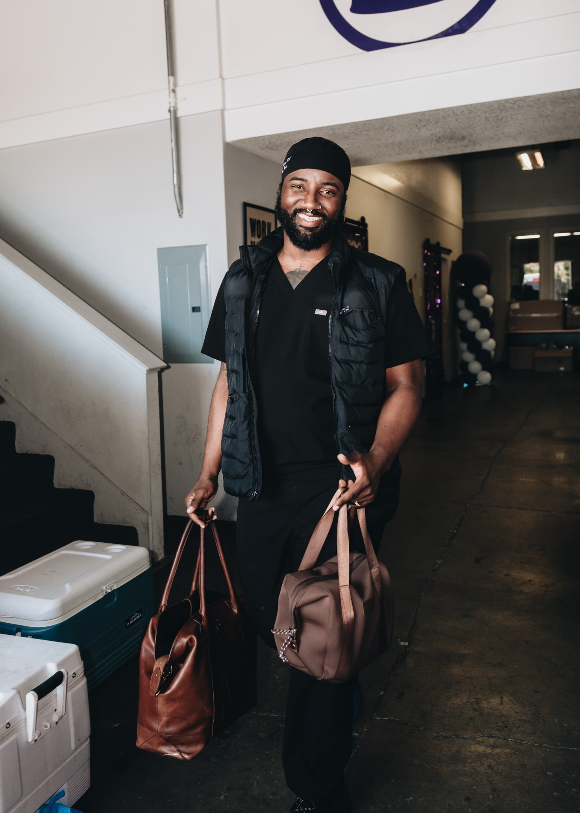 | [A smiling colleague at the base](photos/19-royal-a-smiling-colleague-at-the-base.jpg) | People / everyday culture | 1463 × 2048 |
| 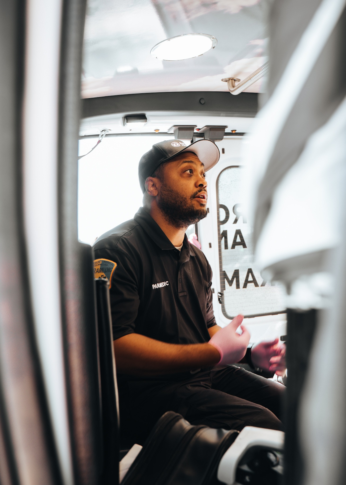 | [A colleague inside the ambulance](photos/20-royal-a-colleague-inside-the-ambulance.jpg) | Everyday work / people | 1463 × 2048 |

---

## What is in this folder

```
for-humans/
├── README.md                          You are reading it
├── Royal-Ambulance-logo-sheet.html    Open in a browser. Every logo and color on one page
├── data-color-sheet.html              Open in a browser. Every chart color on one page
├── logos/svg/                         Vector. Use these
├── logos/png/                         Raster, transparent background
├── previews/                          The images shown above
├── photos/                            Twenty photographs for handbooks and culture pieces, with manifest.csv
├── fonts/                             The brand typeface, variable file
│   └── static/                        Regular, SemiBold, Bold, ExtraBold as single files
└── pack.json                          The list this folder is built from. Ignore it
```

## The other brands in the house

Three brands, one set of rules. Type, neutrals, alert colors and chart colors are shared. Each brand has the same pack in the same place.

| Brand | Pack |
|---|---|
| Collective Edge · the parent | [collective-edge-brand-kit/for-humans](https://github.com/collective-edge/collective-edge-brand-kit/tree/main/for-humans) |
| Apex Paramedics | [apex-brand-kit/for-humans](https://github.com/collective-edge/apex-brand-kit/tree/main/for-humans) |

## Questions

Anything this folder does not answer, ask before you guess. The brand owner would rather answer a question than correct a proof.
