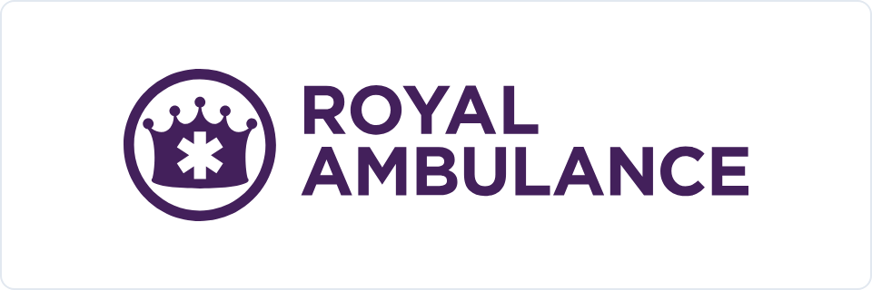
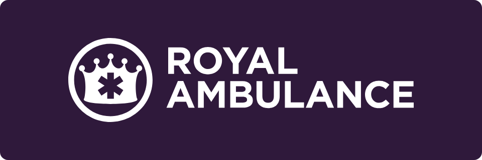
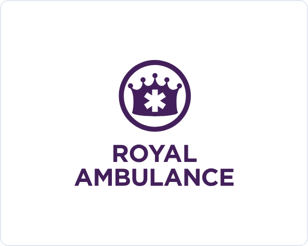
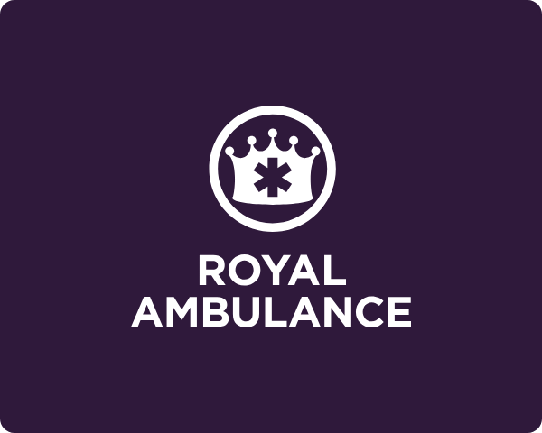
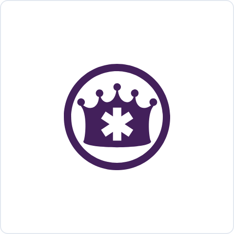
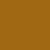

# Royal Ambulance · logo and brand pack

Everything needed to put the Royal Ambulance brand on something. No install, no account, no git.

If you only read one line: use the SVG files, set type in Montserrat, and the purple is `#43205b`.

If you are building anything with a **chart, a table of numbers or a dashboard**, read [Color for data](#color-for-data) below as well. The purple palette is for the brand. It is deliberately not what you color a chart with.

---

## Download

**[⬇ Download the whole pack](https://github.com/collective-edge/royal-brand-kit/archive/refs/heads/main.zip)** · logos, font and this guide in one zip. Unzip it and open the `for-humans` folder.

For one file on its own, click its **SVG** or **PNG** link in the table below, then use the download button on the page that opens.

`Royal-Ambulance-logo-sheet.html` will not render on GitHub. Download it and open it in a browser.

---

## The logos

Pick by the background you are placing it on. The file named **purple** goes on light. The file named **white** goes on dark. The name is the ink color, not the background.

| | Lockup | Files |
|---|---|---|
|  | **Horizontal · purple**<br>The primary lockup. Use it anywhere with room across. Place on white and light grounds. | [SVG](logos/svg/Royal-Ambulance-horizontal-purple.svg)<br>PNG [1200w](logos/png/Royal-Ambulance-horizontal-purple-1200w.png) · [2400w](logos/png/Royal-Ambulance-horizontal-purple-2400w.png) |
|  | **Horizontal · white**<br>The same lockup for dark purple grounds. | [SVG](logos/svg/Royal-Ambulance-horizontal-white.svg)<br>PNG [1200w](logos/png/Royal-Ambulance-horizontal-white-1200w.png) · [2400w](logos/png/Royal-Ambulance-horizontal-white-2400w.png) |
|  | **Stacked · purple**<br>Portrait formats, tight columns and squares. Place on white and light grounds. | [SVG](logos/svg/Royal-Ambulance-stacked-purple.svg)<br>PNG [1200w](logos/png/Royal-Ambulance-stacked-purple-1200w.png) · [2400w](logos/png/Royal-Ambulance-stacked-purple-2400w.png) |
|  | **Stacked · white**<br>The same lockup for dark purple grounds. | [SVG](logos/svg/Royal-Ambulance-stacked-white.svg)<br>PNG [1200w](logos/png/Royal-Ambulance-stacked-white-1200w.png) · [2400w](logos/png/Royal-Ambulance-stacked-white-2400w.png) |
|  | **Crown · purple**<br>Icon only. Favicons, badges, social avatars, app tiles. Place on white and light grounds. | [SVG](logos/svg/Royal-Ambulance-crown-purple.svg)<br>PNG [512](logos/png/Royal-Ambulance-crown-purple-512w.png) · [1024](logos/png/Royal-Ambulance-crown-purple-1024w.png) |
|  | **Crown · white**<br>The same mark for dark purple grounds. | [SVG](logos/svg/Royal-Ambulance-crown-white.svg)<br>PNG [512](logos/png/Royal-Ambulance-crown-white-512w.png) · [1024](logos/png/Royal-Ambulance-crown-white-1024w.png) |

**Use the SVG wherever the software will take it.** It is vector, so it stays sharp at any size. The PNGs are for software that will not accept SVG. They have transparent backgrounds, so the white versions look blank until you place them on something dark.

Pasting a URL straight into a design tool works too. The pattern is:

```
https://cdn.jsdelivr.net/gh/collective-edge/royal-brand-kit@main/for-humans/logos/svg/Royal-Ambulance-horizontal-purple.svg
```

---

## Sizes and spacing

| Rule | Value |
|---|---|
| Clear space on all four sides | Equal to the height of the crown mark |
| Smallest the horizontal lockup may go | 110 px on screen, 1 inch in print |
| Smallest the crown may go | 32 px on screen |
| Logo width in a letterhead header band | 1.4in to 1.8in |

## Do not

- Stretch, squash, skew or rotate it.
- Recolor it. Pick the file that matches the background instead.
- Change the color to anything but Royal Purple `#43205b` or white.
- Add a drop shadow, glow, outline or gradient.
- Pull the crown apart from the wordmark in the horizontal lockup.
- Put it on a busy photo without a solid backing panel behind it.
- Use it below the minimum sizes above.

---

## Color

Hex and RGB are the authoritative values. Everything else gets converted from these.

| | Name | Hex | RGB | What it is for |
|---|---|---|---|---|
|  | Dark Purple | `#2f193b` | 47, 25, 59 | The dominant brand color. Header bands, hero backgrounds, full-width bands |
|  | Purple | `#572e72` | 87, 46, 114 | The workhorse accent. Buttons, links, rules, callout borders, purple text on white |
|  | Royal Purple | `#43205b` | 67, 32, 91 | The logo color on light backgrounds |
|  | Light Purple | `#8260a2` | 130, 96, 162 | Tertiary accents and hover states only |
|  | Charcoal | `#1E293B` | 30, 41, 59 | Body text |
|  | Muted gray | `#64748B` | 100, 116, 139 | Captions, secondary text |
|  | Hairline | `#E2E8F0` | 226, 232, 240 | Table rules, card borders |
|  | Surface | `#faf5fd` | 250, 245, 253 | Very light purple tint for alternating rows and callout fills |
|  | White | `#FFFFFF` | 255, 255, 255 | Page background |

**These nine colors are for the brand.** They are not the colors you make a chart with. See [Color for data](#color-for-data).

Two things that will bite you, both measured:

- **Light Purple `#8260a2` is never body text and never a large background.** It is a tertiary accent and a hover state, nothing more.
- **Never put Light Purple `#8260a2` on Dark Purple `#2f193b`.** It measures 3.13:1 and fails at every size. On a dark background use `#E0D6E8` for body text and `#B0A2BC` for captions.

White text belongs only on Dark Purple, Purple or Royal Purple. Never white on Light Purple.

No CMYK build is specified for this brand. For offset or large-format work, convert from the hex values above and send a proof before the run.

---

## Color for data

Skip this if you are making a logo, a sign or a business card. Read it if anything you are making has a chart, a graph, a dashboard, a scorecard or a table of numbers.

**The brand palette is the wrong tool for a chart, and we can prove it.** The old rule said chart bars should use four shades of the brand purple. Measured against the standard test for whether two colors can be told apart, two of those four scored 6.6 where the passing mark is 15. Not "hard for color blind readers". Hard for everybody. So the data colors below are a separate set, and they are the same in every one of our brands.

### The one rule

When there is data on the page, color has a job: separate things, and signal things. The brand is carried by the band at the top, the logo and the typeface. Not by the bars.

### Series colors · telling things apart

For charts with more than one line, bar group or slice. **Use them in this order, starting at the first one.** Do not pick the ones you like. The order is what keeps neighboring colors distinguishable, including for the roughly one man in twelve who cannot separate red from green.

| | Name | On white | On a dark purple band |
|---|---|---|---|
|  | Purple | `#572e72` | `#be6df2` |
|  | Green | `#1a9d4b` | `#1ba04d` |
|  | Amber | `#dca821` | `#f3ba26` |
|  | Red | `#d42320` | `#e6443a` |
|  | Teal | `#1a97a3` | `#22b6c4` |
|  | Orange | `#e6811c` | `#f78b1f` |
|  | Blue | `#116dce` | `#519dfa` |
|  | Pink | `#e53975` | `#fb608e` |

Three of these is the limit on scatter plots, bubble charts and maps, where any two dots can end up touching. Eight is the limit everywhere else. If you need a ninth, group the smallest ones into "Other" or split the chart in two. Do not invent a color.

Amber and orange are light. If a series uses one, put its number directly on the bar or beside the line.

### Direction colors · telling the reader how to feel

Separate from the series colors, and never mixed with them.

| | Name | Hex | Pale fill | Text on that fill |
|---|---|---|---|---|
|  | Favorable | `#158840` | `#daf8df` | `#127e3b` |
|  | Unfavorable | `#db3931` | `#fde9e6` | `#c5372f` |
|  | Caution | `#a36912` | `#fdebd7` | `#95600f` |
|  | Neutral | `#64748B` | `#F1F5F9` | `#51607A` |

**The part that is easy to get backwards.** Green does not mean the number went up. Green means the news is good.

In one of our reports, transports rose 6.3 percent and hospital invoice costs fell 38.8 percent. One number went up, one went down, and both were good news. Both are green. The little arrow shows which way the number moved. The color shows whether that is good.

Coloring a 38.8 percent cost saving red because it has a minus sign in front of it tells the reader we made things worse.

**Always put an arrow or an icon and a word next to the color.** Never the color on its own. Decks get printed in black and white, projected onto washed-out screens, and read by people who cannot see the difference between your red and your green.

### The before-and-after chart

The most common chart we make, and the one most often got wrong.

Do not use a light shade of purple for "before" and a dark shade for "after". They are too close together, so the reader has to stop and read the labels to work out which bar is which.

Use a plain gray for the baseline and the brand purple for the result:

- Baseline bar · `#CBD5E1`
- Result bar · `#572e72`
- The change, as a pill with an arrow and a word · direction colors above
- The headline number stated once, in dollars rather than a percentage

Gray against purple reads instantly. That is the whole fix.

### The purple ramp · for "how much"

For heatmaps and intensity grids, where one quantity gets darker as it gets bigger. Light to dark:

`#f0e1fd` · `#e2c2fb` · `#d29ef8` · `#ba7ce4` · `#9d60c6` · `#7f42a6` · `#572e72`

It finishes on Royal Purple, so the brand color is the darkest step. Start at the third one for anything with distinct steps, like funnel stages. The first two are so pale they are only usable on a smooth gradient.

**Never use this ramp for things that merely have names.** Facilities, payers and crews are not more or less of anything, and shading them light to dark invents a ranking that is not there. Use the series colors.

### Quick don't list

- Two shades of purple standing in for two different things.
- Red and green as the two ends of one scale. They become the same color for a lot of readers. Use red and teal.
- A red number when the news is good.
- A ninth series color.
- Brand purple on every bar.
- Any color doing its job without a label.

### If you want to check your own work

Everything above was measured rather than picked by eye. If you have a set of colors you want tested, send them to us and we will run them, or run it yourself from the repository:

```
python3 scripts/validate-palette.py "#572e72,#1a9d4b,#d42320"
```

It reports whether the colors are distinguishable, including under the common forms of color blindness, and whether they have enough contrast against the page.

---

## Type

The brand is set in **Montserrat** throughout. There is no secondary typeface.

The variable font file is in [`fonts/`](fonts/). It is also free from Google Fonts at https://fonts.google.com/specimen/Montserrat, which is the better source if you want the full static family.

Headings are bold. Display statements on a title, band or divider are uppercase and letter-spaced, and never run past four words. Headings inside a document are sentence case.

## Writing, if you are setting copy

- Short declarative sentences. Active verbs. Nothing before the point.
- No em dashes. Use a period, a comma, or `·`.
- A label and a value, nothing between them. No helper text under a field, no caption restating the number above it.
- Name partners and facilities exactly the way they write themselves.

---

## What is in this folder

```
for-humans/
├── README.md                          You are reading it
├── Royal-Ambulance-logo-sheet.html    Open in a browser. Every mark and color on one page
├── data-color-sheet.html              Open in a browser. Every chart color on one page
├── logos/svg/                         Vector. Use these
├── logos/png/                         Raster, transparent background
├── previews/                          The images shown above
└── fonts/                             The brand typeface
```

## Questions

Anything this folder does not answer, ask before you guess. The brand owner would rather answer a question than correct a proof.
